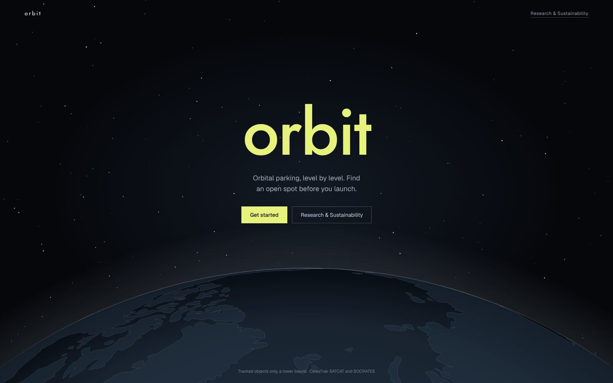
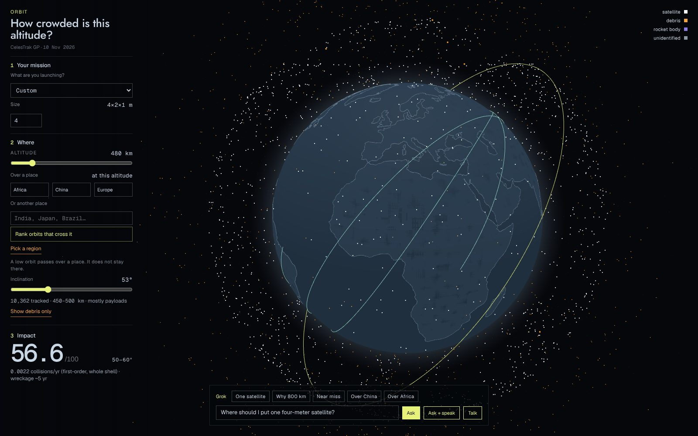

<div align="center">

# Orbit Prototype

### Find a Parking Spot in Orbit

The same interface and backend as the full Orbit project, on a smaller data set.<br>
An interactive globe of tracked objects and a **0–100 placement score** for any altitude and inclination.

<p>
  <a href="#quickstart"></a>
  <a href="#how-it-works"></a>
  <a href="#how-it-works"></a>
  <a href="#data"></a>
  <a href="#quickstart"></a>
</p>

</div>

> [!IMPORTANT]
> **Tracked objects only: every number is a lower bound.**<br>
> Orbit counts what the public catalog tracks, roughly everything over 10 cm. It shows crowding, never a "collision probability".

---

## Overview

Orbit viewers show where things are, but not where it is **safe** to put something. This prototype answers one question: **if I launch here, how bad is it?**

Pick what you are launching, drag the altitude and inclination, and the globe draws your orbit among the tracked objects. The score weighs how likely a collision is **and** how long the wreckage would stay up.

<div align="center">
  
</div>

<div align="center">
  
</div>

---

## What Is in This Prototype

The interface and the backend are the same code as the full project. Only the data is smaller.

| Works here | Smaller than the full project |
| :--- | :--- |
| Globe with live SGP4 motion, orbit and ground track | The globe draws a **4,376-object sample** of the 20,167 tracked objects (all rocket bodies, about half the debris, a third of unknowns, a sixth of satellites, plus every object in the 50 closest near misses) |
| 0–100 placement score, shell crowding, closest near miss | Shell counts, scores and near misses use the **full snapshot**, so they will not match the number of dots |
| Region ranking (Africa, China, Europe, or any named place) | Raw catalog files and the data pipeline are not included |
| Ask bar, answered offline by local rules | Voice and Grok answers need an xAI key (optional) |

---

## How It Works

| Piece | Role |
| :--- | :--- |
| `web/src/propagate.worker.ts` | Propagates every object with SGP4 in a web worker |
| `web/src/App.tsx` | The globe (`globe.gl` + `three.js`) |
| `web/src/PlacePanel.tsx`, `AgentPanel.tsx` | Mission picker, score panel, Ask bar |
| `api/` | FastAPI: `/place`, `/locations`, `/ask`, `/close_approaches` |
| `pipeline/scoring.py` | The placement score and shell table |
| `data/out/*.json` | The data snapshot (see below) |

### The Placement Score

| Step | What happens |
| :---: | :--- |
| **1** | **Shell density:** tracked objects ÷ shell volume, for each 50 km shell from 300 to 2,000 km. |
| **2** | **Collision rate:** `n × 10 km/s × area × year`, with `area = π (r + 0.5 m)²`. Your other satellites in the shell are added. |
| **3** | **Lifetime:** how long a dead satellite stays up. 500 km → 8 years · 800 km → 200 years · 1,000 km → 1,000 years. |
| **4** | **Three factors:** harm (rate × lifetime) **0.8**, collisions **0.1**, density **0.1**, log-scaled over the 500–2,000 km shells. |
| **5** | **Score:** scaled to 0–100, then moved up to ±12 by how quiet the inclination band is. |

---

## Quickstart (for judges)

You need **two terminals**: one for the backend, one for the web app. No account, API key or internet connection is needed once the dependencies are installed. It takes about five minutes.

### Prerequisites

| Tool | Version | Check |
| :--- | :--- | :--- |
| Node.js + npm | 18 or newer (LTS) | `node -v` |
| Python | 3.11 or newer | `python --version` |
| uv (Python package manager) | any | `uv --version` (install with `pip install uv`) |
| Git | any | `git --version` |

### 1. Clone

```bash
git clone https://github.com/potato4550/orbit_protoype.git
cd orbit_protoype
```

### 2. Terminal 1: start the backend

```bash
uv sync
uv run uvicorn api.main:app --port 8000
```

Wait for `Application startup complete`. Leave this terminal open.

<details>
<summary>No uv? Use plain pip instead</summary>

```bash
python -m venv .venv
# Windows:  .venv\Scripts\activate      macOS/Linux:  source .venv/bin/activate
pip install numpy pandas openpyxl skyfield fastapi "uvicorn[standard]" openai httpx python-dotenv pydantic python-multipart
python -m uvicorn api.main:app --port 8000
```
</details>

### 3. Terminal 2: start the web app

```bash
cd orbit_protoype\web
npm install
npm run dev
```

Open the URL it prints, usually **http://localhost:5173**, and click **Get started**. The globe takes a few seconds to load the first time.

### 4. What to try (about two minutes)

| Do this | You should see |
| :--- | :--- |
| Leave the defaults (4×2×1 m satellite, 480 km, 53°) | Score **56.6 / 100**, about **10,362 tracked objects** in the 450–500 km shell |
| Drag the **Altitude** slider up to 800 km | The score drops and the wreckage time grows to hundreds of years |
| Click **Africa**, **China** or **Europe** | A ranked list of orbits that pass over that region, quietest first |
| Type **Where should I put one four-meter satellite?** and press **Ask** | A written answer, and the globe flies to the suggested orbit |
| Click the **Near miss** chip | The closest predicted close approach in the snapshot |

### Troubleshooting

| Problem | Fix |
| :--- | :--- |
| Globe loads but the region buttons or Ask fail | The backend is not running. Check Terminal 1 for `Application startup complete`. |
| `Address already in use` on port 8000 | Start the backend with `--port 8001`, then start the web app with `API_PORT=8001 npm run dev` (Windows: `set API_PORT=8001 && npm run dev`). |
| Vite says port 5173 is busy | Use the other URL it prints. |
| `uv sync` fails on an old `.venv` | Delete the `.venv` folder and run it again. |

### Optional: voice and Grok

Copy `.env.example` to `.env` and set `XAI_API_KEY`. Without it everything above still works: the Ask bar is answered by local rules. The **Talk** and **Ask + speak** buttons need the key.

---

## Roadmap

This prototype is the working core. Next steps toward the full project:

* All 20,167 tracked objects on the globe, not a sample
* Live data refresh from CelesTrak
* Close passes included in the score
* Hosted deployment

---

## Data

Everything is a frozen snapshot, so the prototype works offline and gives the same answer every time.

| File | Used for |
| :--- | :--- |
| `objects.json` | Orbit elements for the sampled objects, drawn on the globe |
| `shells.json`, `leo_shells.json` | Objects and density per 50 km shell (full snapshot) |
| `crowding_grid.json` | Objects per shell and inclination band (full snapshot) |
| `close_approaches.json` | Predicted near misses (full snapshot) |
| `decay_table.json` | Dead-satellite lifetimes by altitude |

Orbit data comes from [CelesTrak](https://celestrak.org) (GP elements, SATCAT and SOCRATES close approaches).

---

## Limits

* **Tracked objects only:** anything under about 10 cm is not in the catalog.
* **Crowding, not probability:** real collision probability needs position-uncertainty data we do not have.
* **First-order model:** dead-satellite lifetime is a rule-of-thumb lookup by altitude.
* **Sampled dots:** the globe shows a sample, so it looks emptier than the real sky.

---

## Team

Developed for **[event name]** by **[team name]**:
* **Contributors**: [add everyone who worked on this]

---

## License

No license has been chosen yet. Third-party data keeps its own license.

**Credits**: [CelesTrak](https://celestrak.org), [satellite.js](https://github.com/shashwatak/satellite-js), [globe.gl](https://globe.gl), [three.js](https://threejs.org), [React](https://react.dev), [Vite](https://vite.dev) and [FastAPI](https://fastapi.tiangolo.com).
